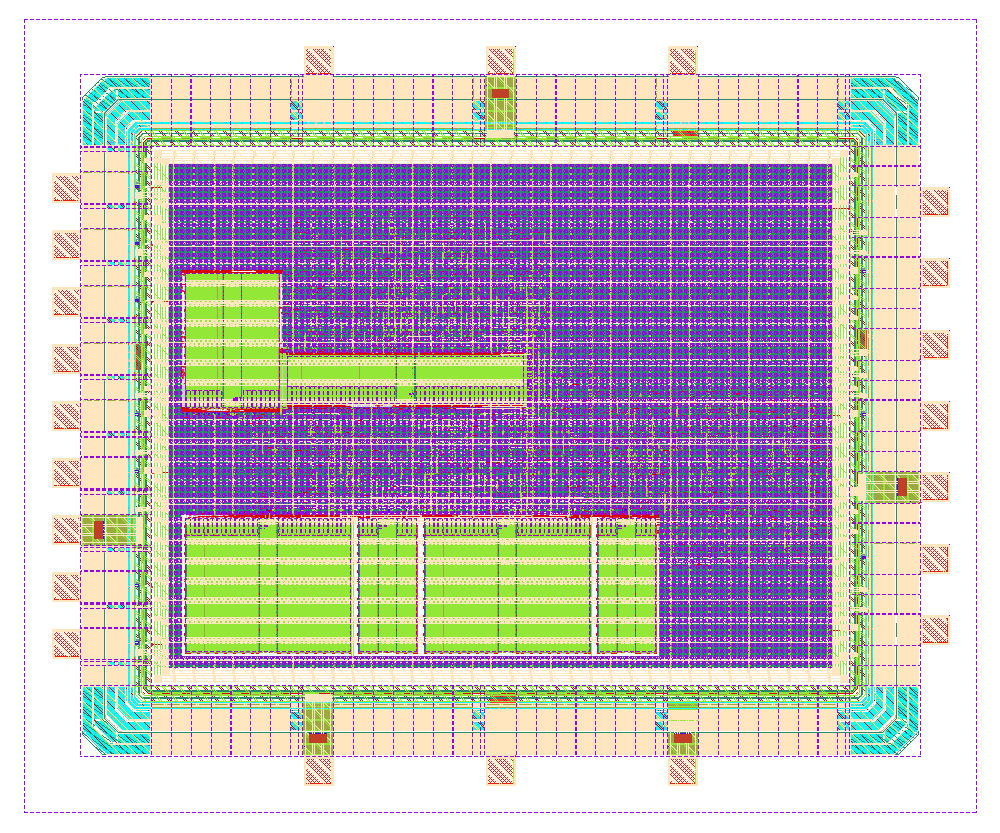

# TPU5555 – Hyperdimensional-Computing Classifier with SPI Interface

TPU5555 is a complete padded chip (IHP SG13CMOS5L, 2.4 mm × 2.0 mm) that runs a
hyperdimensional-computing (HDC) classifier. It encodes 32 feature values into a
1000-bit hypervector, trains class prototypes on chip, and classifies samples by
Hamming distance to up to 8 classes. A host controls it through a byte-oriented
command protocol over SPI (mode 0).

## Key figures

| Parameter | Value |
| --- | --- |
| Technology | IHP SG13CMOS5L (5 metal layers) |
| Die size (incl. seal ring) | 2400 µm × 2000 µm (4.8 mm²) |
| Core area | 2.11 mm² (365…2035 µm × 365…1635 µm) |
| Core / IO supply | 1.2 V / 3.3 V |
| System clock `clk` | 50 MHz (20 ns), setup slack ≥ 2.3 ns in the slow corner |
| SPI clock `sclk` | up to 10 MHz (100 ns constraint), mode 0, MSB first |
| Hypervector length D | 1000 bit (25 × 40-bit words) |
| Features per sample N | 32 (Q15, 0…32767) |
| Quantization levels M | 40 |
| Classes K | ≤ 8 |
| SRAM macros | 6 (IHP `RM_IHPSG13_1P_*`: 2×1024x32, 2×1024x8, 1×256x48, 1×1024x16) |
| Standard cells + macros | ≈ 125 k instances |
| Estimated power | ≈ 0.8 mW (OpenROAD vectorless estimate, typ corner) |

## Pads

22 IO cells from the `sg13cmos5l_io` library, plus 70×70 µm bondpads.

| Pad | Cell | Dir | Function |
| --- | --- | --- | --- |
| `pad_clk` | IOPadIn | in | System clock (50 MHz) |
| `pad_rstn` | IOPadIn | in | Active-low reset |
| `pad_sclk` | IOPadIn | in | SPI clock |
| `pad_cs_n` | IOPadIn | in | SPI chip select, active low |
| `pad_mosi` | IOPadIn | in | SPI data in |
| `pad_miso` | IOPadOut30mA | out | SPI data out |
| `pad_led` | IOPadOut30mA | out | `done` indicator |
| `pad_spare[4:0]` | IOPadIn | in | Unused. These pads are present for the antenna ratio of the IO ring; tie them to GND. |
| VDD ×4, VSS ×4 | sg13cmos5l_IOPadVdd / IOPadVss | – | Core supply 1.2 V |
| IOVDD, IOVSS | sg13cmos5l_IOPadIOVdd / IOPadIOVss | – | IO supply 3.3 V |

## SPI transport

SPI mode 0, MSB first. The master always clocks **byte pairs**:

- `0xA5, b` delivers command byte `b`. Any other first byte is a poll.
- Each pair returns `0x01, data` if a reply byte was pending, otherwise `0x00, x`.
  The reply is shifted out during the *next* pair. For the first pair of a session,
  it is preloaded at the falling edge of `cs_n`.

## Command protocol

All multi-byte fields are little-endian. Most commands reply `'K'` (0x4B), and an
unknown command replies `'E'` (0x45). On every completed operation the chip sends one
result byte: `0x5A` after a finalize, otherwise the recognized class `0x00…0x07`.

| Cmd | Payload | Effect |
| --- | --- | --- |
| `I` / `C` / `A` | addr(2) + data(5) | Write a 40-bit word to item memory / continuous memory / associative memory |
| `W` | sel(`I`/`C`/else AM) + addr(2) + count(2) + count×data(5) | Block write with auto-increment; one `K` at the end |
| `R` | sel + addr(2) | Read back 5 data bytes (no `K`) |
| `F` | value(4) | Push one feature; after the 32nd, start automatically |
| `B` | 32 × value(4) | Push all 32 features and start; one `K` |
| `M` | byte (bit 0) | Set `train_mode` |
| `L` | byte (bits 2..0) | Set the label |
| `X` | – | Finalize the current label (requires `train_mode=1`) |
| `S` | – | Force start |

## Usage

1. After reset, load the item memory (32 vectors) and continuous memory (40 vectors)
   with `W`. Each vector is 25 consecutive 40-bit words.
2. **Power-up caveat:** SRAM contents, including the class counters, are undefined
   after power-up. Issue one dummy finalize (`M 1`, `X`) before training.
3. Training: `M 1`, `L <label>`, then `B` for every sample of that label, then `X`.
   Repeat for each label. Only one counter bank exists, so finish one label before
   starting the next.
4. Inference: `M 0`, then `B <features>`. The chip returns the recognized class.
   Class prototypes can also be written directly with `A`/`W`.
