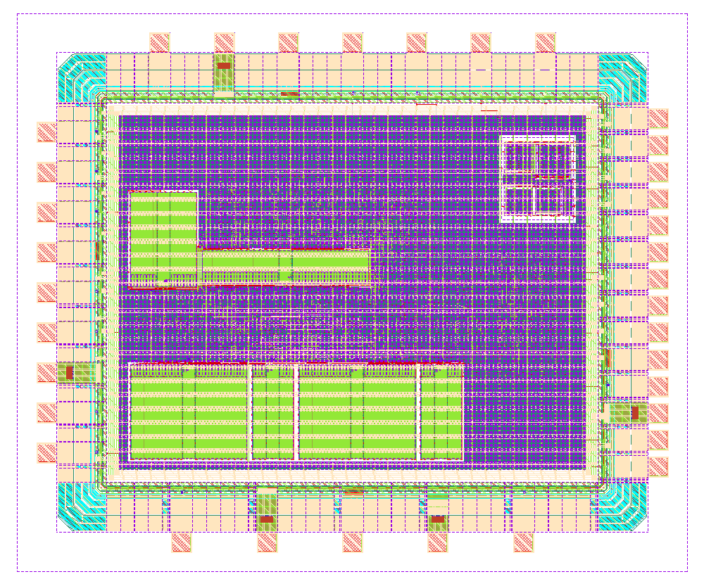

# TPU5555 – Hyperdimensional-Computing Classifier with SPI Interface

TPU5555 is a complete padded chip (IHP SG13CMOS5L, 2.4 mm × 2.0 mm) that runs a
hyperdimensional-computing (HDC) classifier. It encodes 32 feature values into a
1000-bit hypervector, trains class prototypes on chip, and classifies samples by
Hamming distance to up to 8 classes. A host controls it through a byte-oriented
command protocol over SPI (mode 0).

Since v.2.0.0 the chip also carries an all-digital multiplying delay-locked loop (MDLL) as a
separate test structure with its own pads: it multiplies an external reference clock by 4.
It shares only the core supply with the classifier (see *MDLL test structure* below).

## Key figures

| Parameter | Value |
| --- | --- |
| Technology | IHP SG13CMOS5L (5 metal layers) |
| Die size (incl. seal ring) | 2400 µm × 2000 µm (4.8 mm²) |
| Core area | 2.11 mm² (365…2035 µm × 365…1635 µm) |
| Core / IO supply | 1.2 V / 3.3 V |
| System clock `clk` | 50 MHz (20 ns), setup slack ≥ 2.3 ns in the slow corner |
| SPI clock `sclk` | up to 10 MHz (100 ns constraint), mode 0, MSB first |
| Hypervector length D | 1000 bit (25 × 40-bit words) |
| Features per sample N | 32 (Q15, 0…32767) |
| Quantization levels M | 40 |
| Classes K | ≤ 8 |
| SRAM macros | 6 (IHP `RM_IHPSG13_1P_*`: 2×1024x32, 2×1024x8, 1×256x48, 1×1024x16) |
| MDLL macro | 1 (`mdll`, 257.8 µm × 294.8 µm at (1735, 1260) µm, Metal1–Metal4) |
| Standard cells + macros | ≈ 118 k instances |
| Estimated power | OpenROAD vectorless estimate, typ corner: 68 mW, of which 56 mW in the pad group. With the MDLL clock analysed at its 1.25 ns STA period, this is an upper bound, not an activity-based figure. v.1.0.0 (no MDLL): ≈ 0.8 mW. |

## Pads

35 IO cells from the `sg13cmos5l_io` library, plus 70×70 µm bondpads.

| Pad | Cell | Dir | Function |
| --- | --- | --- | --- |
| `pad_clk` | IOPadIn | in | System clock (50 MHz) |
| `pad_rstn` | IOPadIn | in | Active-low reset |
| `pad_sclk` | IOPadIn | in | SPI clock |
| `pad_cs_n` | IOPadIn | in | SPI chip select, active low |
| `pad_mosi` | IOPadIn | in | SPI data in |
| `pad_miso` | IOPadOut30mA | out | SPI data out |
| `pad_led` | IOPadOut30mA | out | `done` indicator |
| `pad_spare[4:0]` | IOPadIn | in | Unused. These pads are present for the antenna ratio of the IO ring; tie them to GND. |
| `pad_mdll_clk_ref` | IOPadIn | in | MDLL reference clock (nominal 100 MHz) |
| `pad_mdll_resetb` | IOPadIn | in | MDLL reset, active low (also resets the /4 divider) |
| `pad_mdll_clk` | IOPadOut16mA | out | MDLL output clock / 4 (at lock: the reference frequency) |
| `pad_mdll_clk_raw` | IOPadOut30mA | out | MDLL output clock (at lock: 4 × reference) |
| `pad_mdll_locked` | IOPadOut4mA | out | MDLL acquisition done (bang-bang tracking active) |
| `pad_mdll_code[7:0]` | IOPadOut4mA | out | MDLL DCO control code |
| VDD ×4, VSS ×4 | sg13cmos5l_IOPadVdd / IOPadVss | – | Core supply 1.2 V |
| IOVDD, IOVSS | sg13cmos5l_IOPadIOVdd / IOPadIOVss | – | IO supply 3.3 V |

Pad order per side (pads are spaced evenly along each side):

| Side | Order | Pads |
| --- | --- | --- |
| West | bottom → top | `rstn`, `spare[0]`, VDD, `clk`, `spare[1]`, VSS, `sclk`, `spare[2]`, `cs_n` |
| South | left → right | `spare[3]`, VDD, VSS, IOVDD, `spare[4]` |
| East | bottom → top | `miso`, `led`, VDD, `mosi`, VSS, `mdll_locked`, `mdll_code[0]` … `mdll_code[7]` |
| North | left → right | IOVSS, VDD, VSS, `mdll_resetb`, `mdll_clk_ref`, `mdll_clk`, `mdll_clk_raw` |

On the east side the bondpad pitch is about 96 µm (14 pads); the other sides are wider.

## SPI transport

SPI mode 0, MSB first. The master always clocks **byte pairs**:

- `0xA5, b` delivers command byte `b`. Any other first byte is a poll.
- Each pair returns `0x01, data` if a reply byte was pending, otherwise `0x00, x`.
  The reply is shifted out during the *next* pair. For the first pair of a session,
  it is preloaded at the falling edge of `cs_n`.

## Command protocol

All multi-byte fields are little-endian. Most commands reply `'K'` (0x4B), and an
unknown command replies `'E'` (0x45). On every completed operation the chip sends one
result byte: `0x5A` after a finalize, otherwise the recognized class `0x00…0x07`.

| Cmd | Payload | Effect |
| --- | --- | --- |
| `I` / `C` / `A` | addr(2) + data(5) | Write a 40-bit word to item memory / continuous memory / associative memory |
| `W` | sel(`I`/`C`/else AM) + addr(2) + count(2) + count×data(5) | Block write with auto-increment; one `K` at the end |
| `R` | sel + addr(2) | Read back 5 data bytes (no `K`) |
| `F` | value(4) | Push one feature; after the 32nd, start automatically |
| `B` | 32 × value(4) | Push all 32 features and start; one `K` |
| `M` | byte (bit 0) | Set `train_mode` |
| `L` | byte (bits 2..0) | Set the label |
| `X` | – | Finalize the current label (requires `train_mode=1`) |
| `S` | – | Force start |

## Usage

1. After reset, load the item memory (32 vectors) and continuous memory (40 vectors)
   with `W`. Each vector is 25 consecutive 40-bit words.
2. **Power-up caveat:** SRAM contents, including the class counters, are undefined
   after power-up. Issue one dummy finalize (`M 1`, `X`) before training.
3. Training: `M 1`, `L <label>`, then `B` for every sample of that label, then `X`.
   Repeat for each label. Only one counter bank exists, so finish one label before
   starting the next.
4. Inference: `M 0`, then `B <features>`. The chip returns the recognized class.
   Class prototypes can also be written directly with `A`/`W`.

## MDLL test structure

The MDLL (instance `i_mdll`, sources in `TPU5555-main/mdll/`) is a gated ring oscillator
locked to `pad_mdll_clk_ref`. It runs four DCO periods from each reference edge, so at lock
its output runs at 4 × f_ref.
- **Acquisition:** a time-to-digital converter sets the 8-bit DCO code coarsely.
- **Lock:** a bang-bang phase detector then tracks, with the two code LSBs dithered over
  the four periods.

`locked` goes high at the handover to tracking. It drops again and acquisition restarts if
injections go missing or the code sits at either end.

| Parameter | Value |
| --- | --- |
| Multiplication | × 4 (`pad_mdll_clk_raw`); `pad_mdll_clk` = output / 4 |
| Reference | nominal 100 MHz. Closed loop on the extracted layout (Calibre RC), runs finished at release: 100 MHz locks at tt, ss and ff; tt and ff lock from 123 to 150 MHz; ss (1.08 V, 125 °C) locks at 113 MHz and fails from 123 MHz (see Known limitations). The 70–118 MHz runs were still going. |
| Lock time | handover after about 7 (ss) to 33 (tt) reference cycles from `pad_mdll_resetb` rising (simulation, 100 MHz) |
| Lock swing (`div` vs `clk_ref`, at the phase detector) | about 40–200 ps peak-to-peak, depending on where the code locks |
| Code at lock (100 MHz) | about 0x22 (ss) … 0x58 (tt) … 0x98 (ff) |

Usage:
1. Apply the reference to `pad_mdll_clk_ref`, then release `pad_mdll_resetb`. The MDLL
   starts on the next reference edge.
2. Wait for `pad_mdll_locked`. `pad_mdll_code` then changes by about one LSB per reference
   cycle (dither).
3. Measure on `pad_mdll_clk` (same frequency as the reference) or `pad_mdll_clk_raw` (4 ×).
   The raw output tests whether the IO cell passes 400 MHz and above; the divided output is
   the fallback.

The MDLL shares the core supply with the classifier. Measure it first with the classifier
idle (`pad_rstn` low, `pad_clk` stopped), then running, to see its supply sensitivity.
Hold `pad_mdll_resetb` low when the MDLL isn't used: the ring and the 30 mA output then
stay quiet.

## Known limitations

- SRAM contents are undefined after power-up (see Usage above).
- MDLL lock range at the slow corner: between 113 MHz (locks) and 123 MHz (fails) in
  simulation of the extracted layout without the chip's metal fill.
- The chip's metal fill also covers the MDLL's area. The MDLL extraction does not include
  it, so the ring on silicon is slightly slower than simulated, which lowers the ss limit
  further.
